# Data Model

## ER Diagram

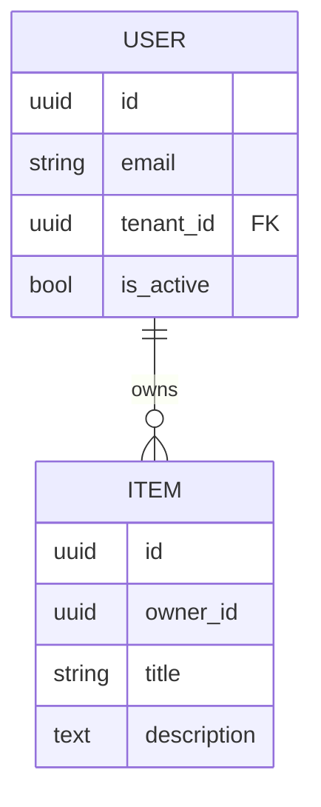

## Entities

### User

| Field | Type | Constraints | Notes |
|-------|------|-------------|-------|
| id | uuid | PK | |
| email | text | unique, not null | synthetic example: user@example.test |
| (no password column) | — | — | auth lives in Supabase (GoTrue); `user.id` = the Supabase auth UID |
| is_active | bool | default true | |
| created_at | timestamptz | default now() | ISO-8601 UTC |

### Item

| Field | Type | Constraints | Notes |
|-------|------|-------------|-------|
| id | uuid | PK | |
| owner_id | uuid | FK -> user.id | |
| title | text | not null | |

## Indexes

- `user(email)` unique
- `item(owner_id)`

## Tenancy (2026-07-12)

All user-facing tables are tenant-scoped; a `tenant` row (id, name, slug unique, is_active) anchors them:

| Table | tenant_id | ON DELETE | Notes |
|-------|-----------|-----------|-------|
| user | not null, indexed | RESTRICT | a tenant with users cannot be deleted |
| item | not null, indexed | CASCADE | |
| ocr_document | not null, indexed | CASCADE | |
| conversation | not null, indexed | CASCADE | `message` scoped transitively via conversation |

Global (deliberately tenant-free, per ADR-0006): `agent`, `tool`, `mcpserver`, `agenttool`, `role`, `permission`.

Bootstrap: migration `b7d4e12a9f03` and `seed_tenants` both insert a **Default** tenant (slug `default`, fixed UUID `00000000-0000-4000-8000-000000000001`, idempotent on slug) and legacy rows are backfilled to it. New signups are assigned the tenant named by `settings.DEFAULT_TENANT_SLUG`.

Enforcement: the tenant filter lives in repo queries — rows outside the caller's tenant are invisible (404, no existence leak); wrong-owner rows inside the same tenant keep 403. Superusers are platform operators and bypass the filter.

DB-level RLS (2026-07-12): migration `c8f2a1d47e56` adds tenant-isolation policies on `user`, `item`, `ocr_document`, `conversation`, `tenant`, and `message` (transitive through its conversation), keyed on the Supabase-compatible `request.jwt.claims` GUC via `app_tenant_id()`. Owners/superusers bypass RLS, so the policies stay dormant until the app engine is flipped to the non-owner `app_user` role — see the runbook's "Row-Level Security & rate limiting" section for provisioning and verification.

## Migrations

- Tool: Alembic
- Naming: `YYYYMMDD_HHMM_description.py`
- Forward + backward compatible during deploys.

## Retention / Privacy

- PII fields: email
- Soft delete vs hard delete:
- GDPR export/erase:

---

## Mobile API domain (2026-10-18)

Every module the mobile app shows has its own tables (revision `536c41f13b56`). Decisions: [ADR-0011](adr/0011-mobile-api-scope-and-local-first-sync.md) (scope, sync), [ADR-0012](adr/0012-per-user-ai-providers.md) (AI keys), [ADR-0013](adr/0013-transport-per-ux.md) (transports), [ADR-0014](adr/0014-aggregate-statistic.md) (the aggregate statistic).

### Conventions

| Rule | Where |
|---|---|
| Every domain row inherits `OwnedRow`: `id` (minted on the device), `owner_id → user CASCADE`, `tenant_id → tenant CASCADE`, `created_at`, `updated_at`, `version`, `deleted_at`. Children carry `owner_id`/`tenant_id` too, so RLS and the sync pull are the same filter everywhere. | `backend/app/shared/owned.py` |
| `version` is stamped by the `set_sync_version()` trigger from the single sequence `sync_version_seq` on every insert and update. It is the sync cursor. Application code never writes it. | migration `536c41f13b56` |
| `deleted_at` is a tombstone. It is shipped by the sync pull and cleared by undo or restore. A natural-key upsert revives a tombstoned holder instead of tripping the unique constraint. | `app/shared/owned_repo.py` |
| Money is `BIGINT` centavos (`*_minor`), with a CHECK on both bounds (±₱1 trillion). | `app/shared/money.py` |
| Business days are `DATE` in the user's clock (`user_profile.timezone`, `day_start_hour`, default Asia/Manila 04:00). Instants are `timestamptz`. | `app/shared/day.py` |
| Rows the server derives (the next recurring task, the record a settled bill writes, a habit ticked by a workout) get `uuid5(namespace, "kind:parent:key")` ids that the device can mint offline too. | `app/shared/ids.py` |
| Value objects that the client always writes whole (habit and routine schedules, task recurrence, planned-item schedule and end rule, share fields, companion blocks) are JSONB validated by the module schema. | module `schema.py` |
| RLS: every table with `tenant_id` has `<table>_tenant_isolation` (`tenant_id = app_tenant_id()`). `weather_cache` is global and holds no user data. | migration `536c41f13b56` |
| Social rows: `owner_id` is the author or actor. Visibility (follow graph, close friends, chat membership) is decided in the services. Social is served by REST and the event stream, not by the owner-scoped pull. | `app/modules/social/models.py` |

### Module map

```mermaid
erDiagram
  user ||--|| user_profile : has
  user ||--o{ module_pref : weights
  user ||--o{ habit : tracks
  habit ||--o{ habit_log : logs
  routine ||--o{ routine_step : steps
  routine ||--o{ routine_run : plays
  user ||--o{ task_list : owns
  task_list |o--o{ task : holds
  task ||--o{ task_event : history
  user ||--o{ workout : trains
  workout ||--o{ workout_exercise : contains
  workout_exercise ||--o{ workout_set : sets
  user ||--o{ meal : eats
  user ||--o{ weigh_in : weighs
  user ||--o{ account : banks
  account ||--o{ fin_record : records
  planned_item |o--o{ fin_record : settles
  statement_import ||--o{ import_row : parses
  user ||--o{ capture : says
  capture ||--o{ record_card : proposes
  record_card ||--o{ card_write_log : audits
  user ||--o{ journal_entry : writes
  user ||--o{ ai_provider_credential : brings
  ai_provider_credential ||--o{ ai_model_assignment : serves
  user ||--o{ daily_module_stat : rolls_up
  user ||--o{ life_score_daily : scores
  user ||--o{ goal : aims
  user ||--o{ notification : inbox
  user ||--o{ post : publishes
  post ||--o{ comment : threads
  user ||--o{ follow : follows
  chat ||--o{ chat_member : members
  chat ||--o{ chat_message : messages
  user ||--o{ media_object : uploads
```

### Tables per module

The diagrams below are generated from the SQLModel metadata by `backend/scripts/erd.py`. The base columns are omitted from each box. Regenerate after any model change:

```sh
cd backend && uv run python scripts/erd.py
```


### `profile`

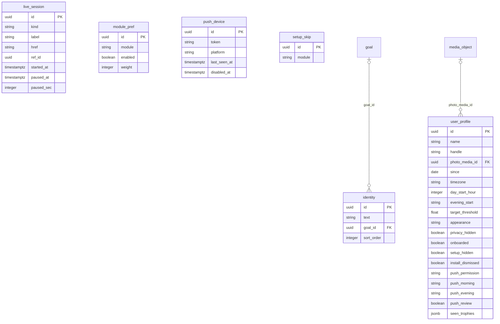

### `media`

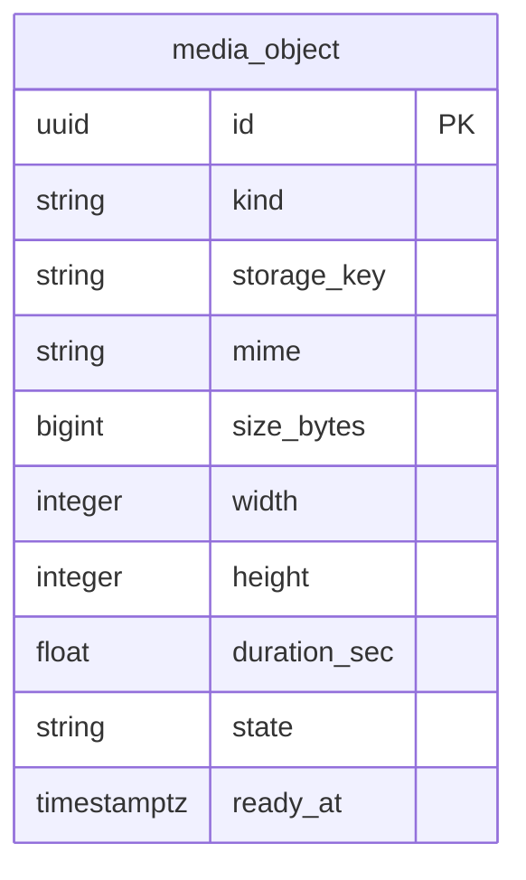

### `habits`

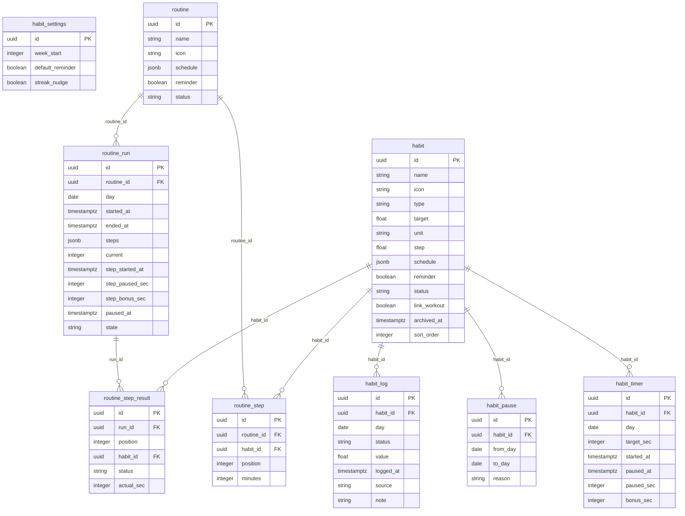

### `tasks`

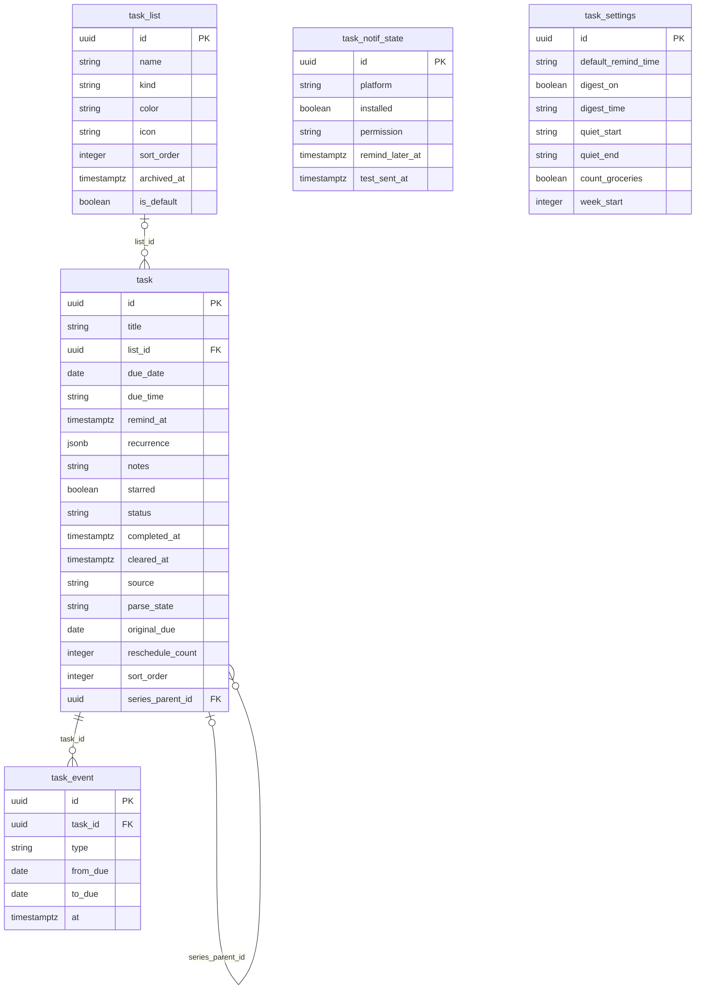

### `fitness`

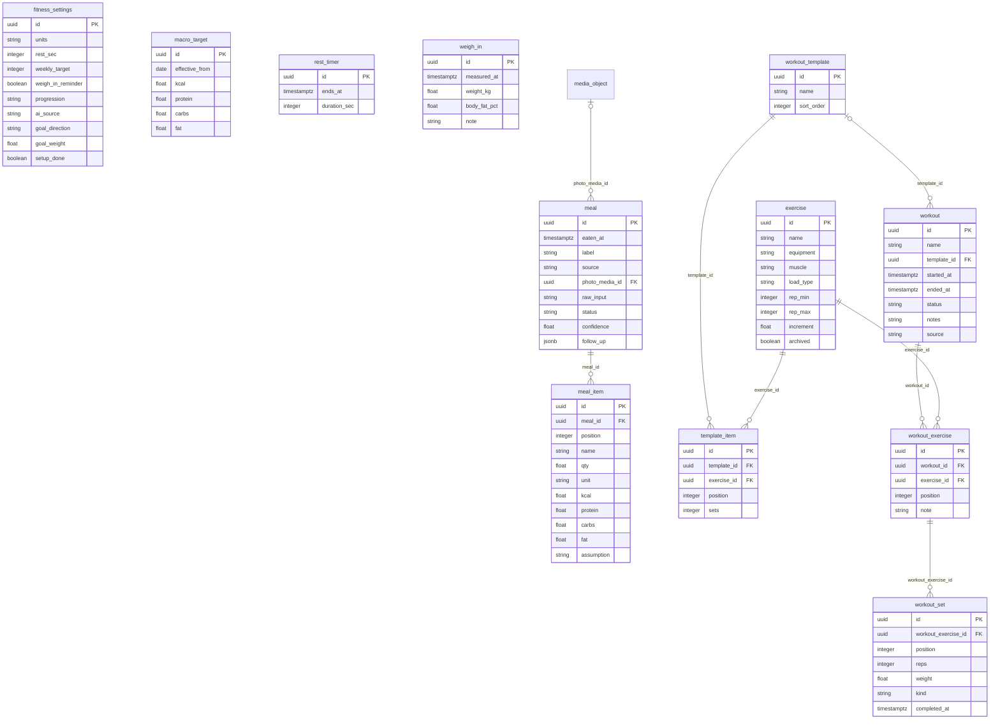

### `finance`

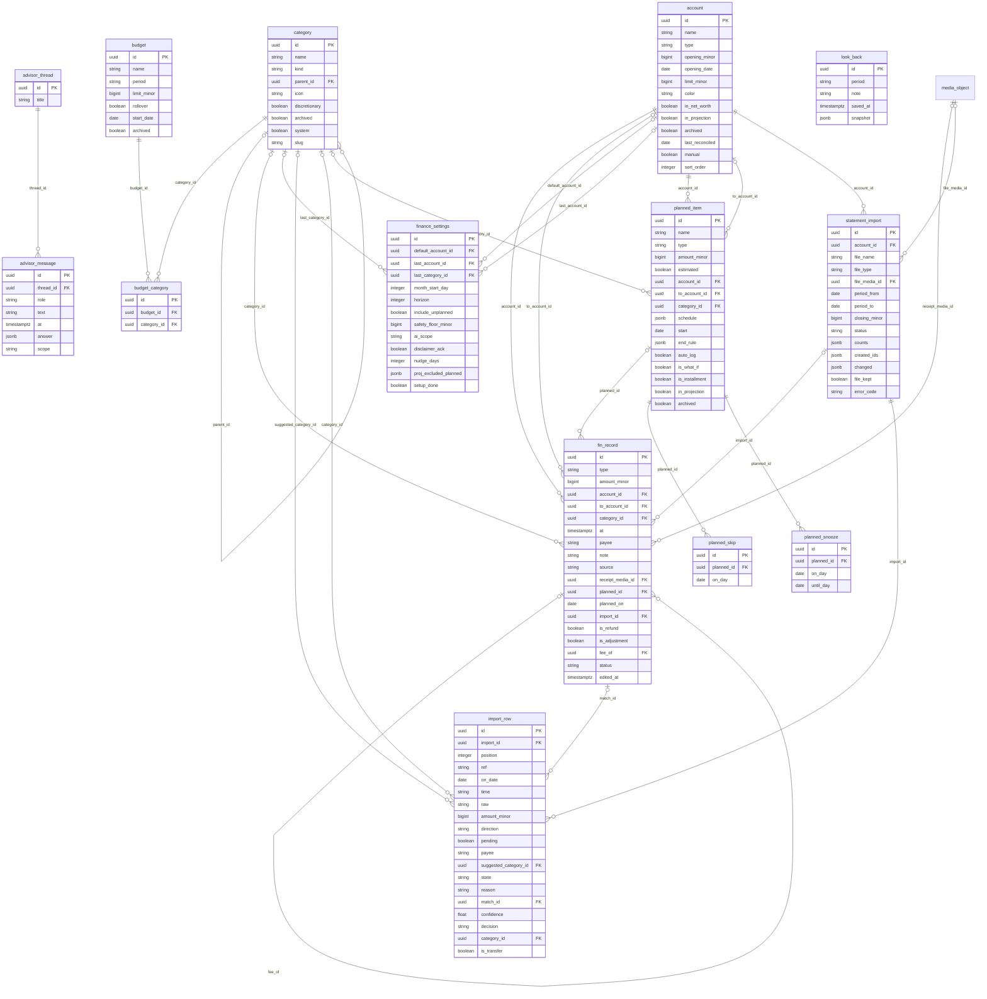

### `capture`

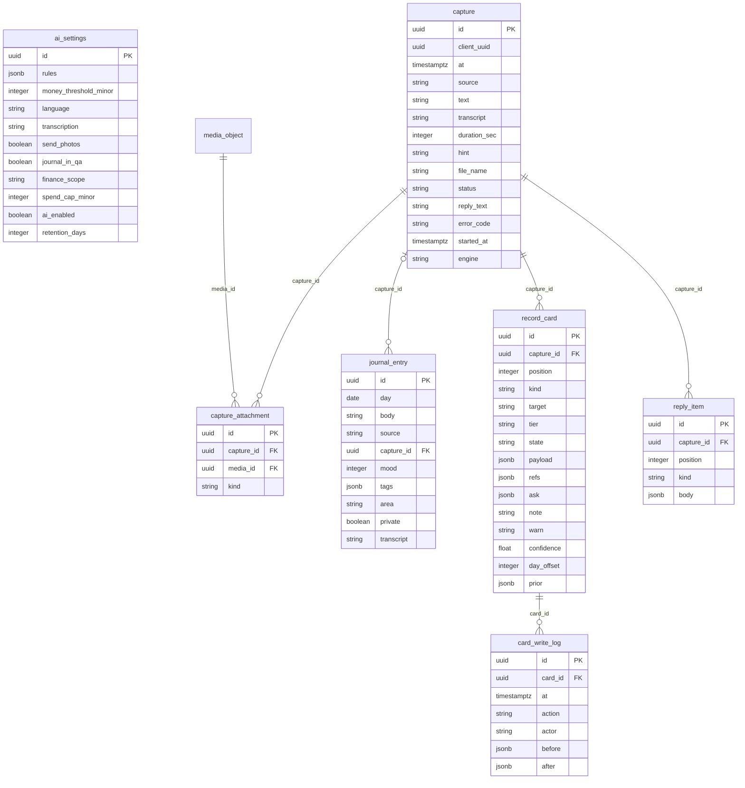

### `ai_providers`

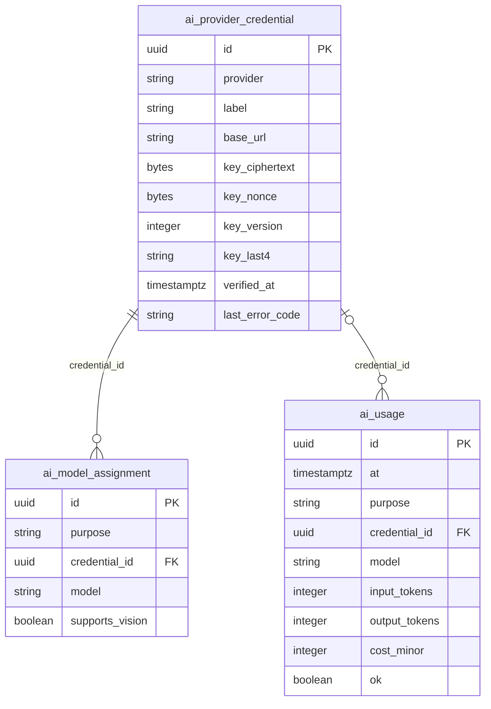

### `stats`

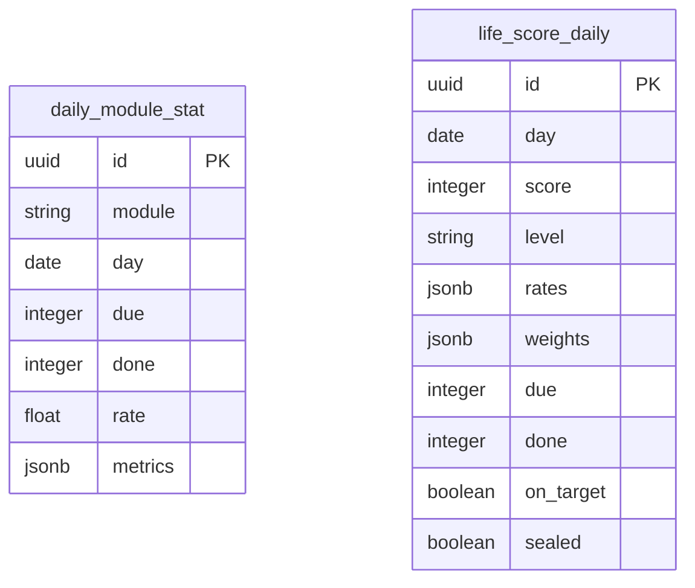

### `dashboard`

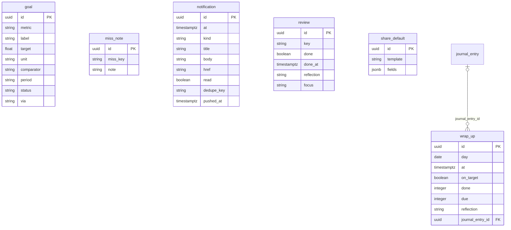

### `companion`

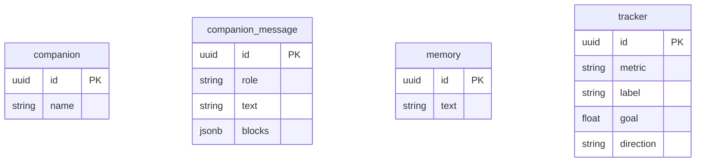

### `social`

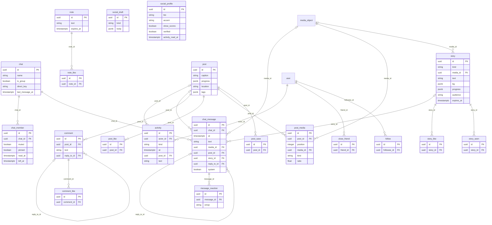

### `weather`

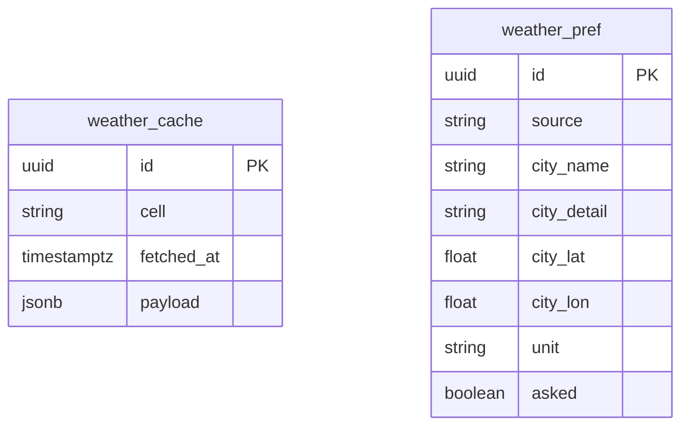

### `sync`

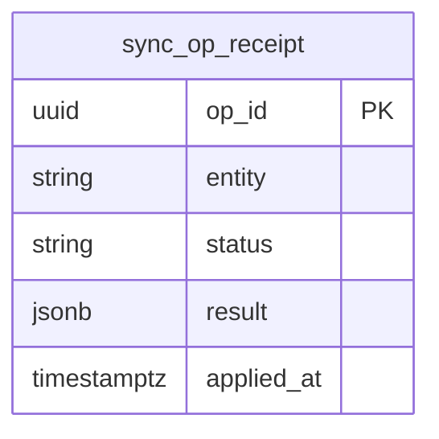

