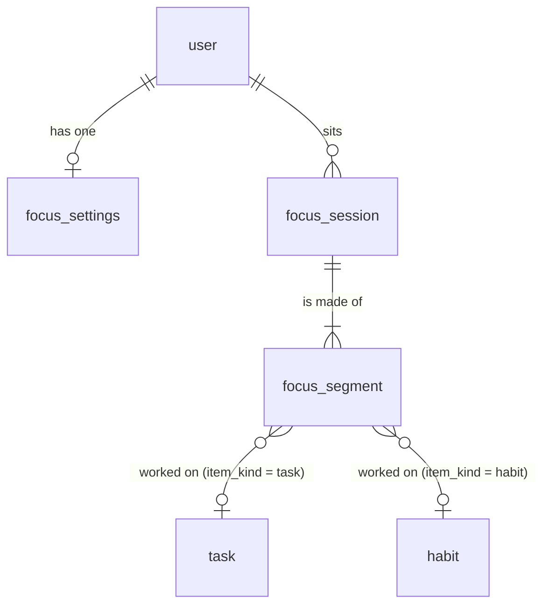

# Focus data model

- **Date:** 2026-10-24
- **Decision record:** [ADR-0025](adr/0025-focus-module.md)
- **Code:** `backend/app/modules/focus/` (models, rules in `logic.py`),
  `shared/prototype/focus/` (the device's copy), migration
  `backend/app/alembic/versions/18269ea0c979_focus_module.py`

The focus timer stores what happened, as timestamps, and derives everything
else. This page is the reference for the three tables, the invariants the
server enforces, and how the derived numbers are computed.

## Entities

Every table inherits the owned-row columns (`id` minted on the device,
`owner_id`, `tenant_id`, `created_at`, `updated_at`, `version` from the
`set_sync_version` trigger, `deleted_at` tombstone) and the tenant
row-level-security policy, like every other module.

### `focus_session`

| Column | Type | Notes |
|---|---|---|
| `mode` | `pomodoro` \| `stopwatch` | |
| `preset` | `25-5` \| `50-10` \| `90-20` \| `custom` \| null | label only; the lengths below are what ran |
| `focus_min`, `short_break_min`, `long_break_min`, `sets_before_long` | int | 1–240, 1–60, 1–120, 1–12 |
| `auto_start_breaks`, `auto_start_focus` | bool | copied from the settings at start |
| `started_at`, `ended_at` | timestamptz | `ended_at` null while the session runs or waits between phases |
| `end_reason` | `completed` \| `abandoned` \| null | abandoned counts nowhere |
| `item_kind`, `item_id`, `item_title` | | what is being worked on now; each new segment copies it |
| `day` | date | **derived**: business day of `started_at` |
| `focus_sec` | int | **derived**: seconds of focus in the session |
| `sets_completed` | int | **derived**: Pomodoro sets whose focus reached their length |

### `focus_segment`

| Column | Type | Notes |
|---|---|---|
| `session_id` | FK → `focus_session`, cascade | a segment never moves between sessions |
| `kind` | `focus` \| `break` \| `pause` | |
| `started_at`, `ended_at` | timestamptz | `ended_at` null: running now |
| `set_index` | int 0–999 | the Pomodoro set this focus, its break, or a pause in either belongs to; a stopwatch is all set 0 |
| `planned_sec` | int 1–86,400 \| null | the set's or break's length, extensions included; null for a stopwatch |
| `item_kind`, `item_id`, `item_title` | | the item for this span; breaks carry none; a pause keeps the item it interrupted |

Indexes: `(owner_id, item_id)` for time on an item, `(owner_id, started_at)`
for day and range reads, plus the usual owner/version/tenant indexes.

### `focus_settings` (one row per user)

`daily_goal_min` (0–960, default 120; 0 turns the goal off), the default
`mode`, `preset` and lengths, the two auto-start switches, and `notify`
(the end-of-set notification). The device writes it under any id; the
server keeps one row per user (`uuid5("focus-settings:<user>:settings")`).

### `task.estimate_min`

Nullable, 1–6,000 minutes. Shown against the task's total focus time.

## Invariants

The server refuses (sync result `rejected`, REST 422/404):

- `ended_at` before `started_at` (`focus_range_invalid`), on a session or a
  segment, including when only one of the two is in the write;
- an item with a kind but no id or the reverse (`focus_item_invalid`);
- a segment whose session is not the caller's, or that names another session
  than the one it was created under;
- a timer action that names a task or habit that is not the caller's (404).

Check constraints in the migration back each of these for writers that skip
the schemas.

## A worked example

A 25/5 Pomodoro on the 20th (Asia/Manila), with a pause and a switch:

| Segment | kind | set | start | end | planned | item |
|---|---|---|---|---|---|---|
| 1 | focus | 0 | 09:00 | 09:25 | 1,500 | Write the ADR (task) |
| 2 | break | 0 | 09:25 | 09:30 | 300 | — |
| 3 | focus | 1 | 09:30 | 09:40 | 1,500 | Write the ADR |
| 4 | pause | 1 | 09:40 | 09:45 | 1,500 | Read (habit; switched while paused) |
| 5 | focus | 1 | 09:45 | 10:00 | 1,500 | Read |

Derived: `day` 2026-10-20, `focus_sec` 25 + 10 + 15 = 3,000, `sets_completed`
2 (set 1's focus is 10 + 15 = 25 minutes). Time by item: the task 35 min, the
habit 15 min. The pause is 5 minutes on the timeline and in no total.
(This is the fixture in `backend/tests/modules/focus/api/test_focus_api.py`.)

## Derived numbers

| Number | Rule |
|---|---|
| Where the timer is | `phase(advance(segments, now), now)`: running, paused, waiting (between phases: what comes next) or ended; the kind, set, elapsed and remaining seconds, and when it ends |
| Session focus | union of its focus segments' spans (an open one up to now, capped at 12 hours) |
| Day focus | union of every counted focus span (sessions not abandoned) clipped to `[day start, next day start)` in the person's clock |
| Time on an item | union of the item's counted focus spans |
| Goal day | a day from the first counted session on, while the goal is on; met when day focus ≥ `daily_goal_min × 60` |
| Goal streak | consecutive met days ending today (today counts once met and does not break the run while open) |
| Area rate | mean over the window's goal days of `min(1, day focus / goal)`; null with no goal day |

## Sync

| Entity | Pushed as | Notes |
|---|---|---|
| `focus_session` | field upserts, delete | `create_required`: `started_at`; derived fields are read back, never sent |
| `focus_segment` | field upserts, delete | `create_required`: `session_id`, `kind`, `started_at`; a segment the timer opened by itself has a derived id both sides mint |
| `focus_settings` | field upserts | one row per user |

The device's mapper order is sessions, then segments, then settings, so a
segment's create never reaches the server before its session's.

## API

`/api/v1/focus`: `GET /today`, `GET /range?first&last`, `GET /day?day`,
`GET /items/{task|habit}/{id}`, `GET /sessions?day`, `GET /current`,
`GET|PUT /settings`, `POST /sessions` (start), `POST /current/{pause,
resume, next, skip-break, extend, switch, stop}`, `GET|DELETE
/sessions/{id}`.
