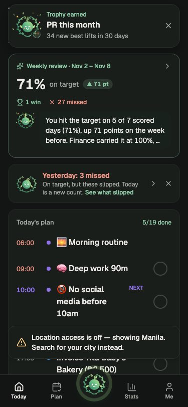

# 27 — Retention audit

2026-11-12. An audit of every page and feature in the mobile app for what keeps a person coming back, and what pushes them away. It covers what [26-retention-algorithms.md](26-retention-algorithms.md) and Slice 1 ([PR #372](https://github.com/Real-Solutions-PH/personal-sop/pull/372)) already decided, and ends with a ranked plan of ten session-sized fixes. Read with [25-retention-kpis.md](25-retention-kpis.md) (what we measure).

**Status: findings and plan only.** No app code changed.

## How this was done

| Method | Covered | Not covered |
|---|---|---|
| **Ran the app** on web, prototype mode (no `.env.local`, sample data), 375 × 812, dark, headless Chromium, signed-in returning user | First screen of Today, Plan, Fern, Stats, Me, Habits, Tasks, Finance, Nutrition, Fitness, Community, Focus, Journal, Settings, Wrap-up; the welcome screen for a new install | Native-only behaviour (pushes, iOS notification cap, haptics); any screen below the first 812 px |
| **Walked onboarding** with a script | Welcome → "Get started" → the identity picker | The script stopped at the identity picker (it needs a selection). Onboarding length and timings below come from the code. |
| **Read the code** | Every screen under `mobile/src/app/(sop)/`, the helpers in `mobile/src/prototype/`, the backend push jobs, sync engine and Fern allowance | Production data: no KPI numbers are quoted here. Run `backend/scripts/retention_report.py` for them. |

Line references are `file:line` at `origin/master` c8021a16. Short screen names (`today.tsx`, `plan.tsx`) are in `mobile/src/prototype/screens/`.

## Summary: the ten findings that cost the most retention

| # | Finding | Who hits it, when | Sev | Evidence |
|---|---|---|---|---|
| F1 | **Two promised pushes are never sent.** Onboarding and Settings promise an "Evening · Wrap up the day" push and a "Weekly review · Sunday 19:00" push. Nothing schedules either. The `evening` time only gates the 20:30 streak-at-risk push, which Slice 1 removes. | Everyone who finishes onboarding; the weekly loop has no trigger at all | H | `onboarding.tsx:1000-1016`; `dash-profile.tsx:762-800`; `local-reminders.ts:509-518` (the only reader of `evening`); `backend/app/modules/jobs/tasks.py:19-54` (no review job) |
| F2 | **Today's first screen leads with misses.** With sample data the first 812 px show a trophy banner, "Weekly review · 1 win · ✕ 27 missed", then a red "Yesterday: 3 missed". Today's plan starts below the fold. | Every open, worst after a weak day | H | Screenshot below; `home-layout.ts:80-122` (card order) |
| F3 | **No "what's next".** Finishing the day says "All done for today" (it links to Stats), with no tomorrow preview and no next action. A new user sees "Free day · Nothing due — your streak is safe" on day 1. | Daily: the best moment to set up tomorrow is wasted. Day 1: the first impression is "nothing here" | H | `today.tsx:164-218, 371-378, 1811` |
| F4 | **Plan is read-only for habits and bills.** The Habits segment draws check circles that only open the habit. The Calendar segment can't tick anything and can't mark a bill paid. Undated tasks never show outside Lists. | Kai's own report; anyone planning their day on Plan | H | `plan.tsx:742-781, 884-914, 1189-1256, 373-380` |
| F5 | **Trust breaks in small ways.** One stray tap unticks a habit and wipes its log, streak and standing, with no Undo. "Today's clear" celebrates while overdue tasks are still open. A spend saves with no confirmation at all. Past weekly and monthly reviews show today's numbers, not that period's. | Every daily user, a few times a week | H | `habits.tsx:215-224`; `plan.tsx:139-143`; `finance-record-editor.tsx:173-183, 294-304`; `dash-reviews.tsx:179-233` |
| F6 | **Onboarding is long and the first log gets no answer.** About 15–17 screens, including a forced 3.3 s "Building your plan…" and a 1.2 s hold-to-commit. The first capture (screen 4) is held on the phone until the account exists, so Fern can't answer it until after the account and notification screens. Two promises aren't kept: "Tap + anytime" (the centre button is Fern) and "three a day max" nudges (no daily cap exists). | Every new install; KPI 6 (time to first log ≤ 15 min) | H | `auth-welcome.tsx:41-56`; `onboarding.tsx:79-90, 208-221, 332, 342, 970`; `first-capture.ts:1-10`; `local-reminders.ts:164` |
| F7 | **The Fern allowance would throttle logging.** Chat sends go through `companion ask`, which counts toward the free limit: 15 a day in week one, then 5 (3 in low-price countries). The evening check-in and welcome-back use the capture path, which doesn't count. **Enforcement is off while in testing**, so this hurts the day it's switched on: on day 8, the week the habit forms. | Every free user from day 8, once enforced | H (latent) | `companion/chat.tsx:70, 395`; `backend/app/core/config.py:344-349`; `ai_providers/allowance.py:11-14`; `checkin.tsx:27` |
| F8 | **Overdue tasks pile up with shame and no way out.** Rows say "pushed 4×" in red and the Late tab leads with "N slipped". The only bulk fix is "Move all to today", which moves the pile onto today. Nothing offers to spread tasks over the week, park them for someday, or drop them. | Planners after any busy week: the classic tracker-quit moment | H | `plan.tsx:333-360, 454-478`; `tasks.tsx:348-374, 423-424`; screenshot text "late 8d pushed 4×" |
| F9 | **One reminder time per habit.** Picking a day in one time slot removes it from every other slot, so "08:00 and 20:00 every day" can't be set. "Every day" and "Weekdays" quietly clear the time (turning off the push). The Reminder switch can be on with no time and schedule nothing. | Anyone with a twice-a-day habit (skin care, meds); Kai's own report | H | `habits.tsx:92-102, 133, 138`; `habit-form.tsx:457-483`; `local-reminders.ts:295-297` |
| F10 | **Nothing new when you come back.** No area has a "since you were last here" line. Salary and bills auto-logged while away arrive silently. Likes, comments and follows send no push (only mentions and chat do). Share cards carry no link back. With fewer than 50 users, the Community feed relies on hand-made posts. | Lapsing and casual users: the reason to open is missing | H | `finance-setup.tsx:156` (autoLog); `social/notify.py:125-170`; `social/services.py:555-600`; `share-kit.tsx:2050-2066` |

## 1. Page-by-page

Severity is for retention: **H** = plausibly makes someone stop opening the app, **M** = makes a session worse or weakens a reason to return, **L** = polish.

### 1.1 Today, Plan, Fern, first run

| Route | Job | Retention hooks it has | Problems | Sev | Evidence |
|---|---|---|---|---|---|
| `/today` | The day at a glance, and the home screen | Ring with a target line; Today's plan with NOW/NEXT and ticks; first-week strip; setup card; weekly review card; evening wrap-up and Tomorrow cards | F2 and F3. Ticked plan rows disappear (`shown = open`), so progress shows only as a count. The setup card shows a raw module key ("next: habits") and sits 7th in the default order. Cold start: "Free day", "streak is safe", score "—", "Nothing planned today", and "All clear for today" on Tasks for someone who has never had a task. | H | `today.tsx:164-218, 326, 371-378, 1058-1061, 1987-1989`; `home-layout.ts:80-122` |
| First-week strip | Days 1–7 promise ("Day n is lit") | "Come back tomorrow" | A day lights only when `series.done > 0`, which counts *due* items. A meal or journal entry may not light it (needs a check on device). Nothing follows week 1: the strip just disappears. | M | `daily-strips.tsx:111-114, 154-159`; `rewards.ts:133-141` |
| `/today/wrap-up` | Close the day | Result ring; tick / move to tomorrow / didn't happen; seal stamp; reflection goes to the journal | "Didn't happen" is local state only: it comes back on reopen and records nothing. Sealing returns to Today without planning tomorrow, despite the "tick, push, reflect" copy. With sample data it opens "Off target · 17 more to hit the target". | M | `dash-day.tsx:225, 391-403, 486-501, 2017` |
| `/today/yesterday` | Review misses | Fern's read with retry; cost per miss; notes | Dead end: a miss can't be moved to today or redone. | M | `yesterday.tsx:146-183, 233-242` |
| `/today/checkin` | One-line evening log | Uses capture (not counted toward the allowance) | A single "Done" with nothing after it. The push is **off by default** (`checkin: ""`). | M | `checkin.tsx:46-50`; `shared/prototype/dash/data.ts:339` |
| `/today/welcome-back` | Comeback after 2+ empty days | In doc 26 §1.2 | "Start from today" drops onto Today with no suggested first step. | L | `welcome-back.tsx:38-44, 79-88` |
| `/today/inbox` | In-app notifications | Swipe to mark read; tap through | Dismiss deletes with no undo. | L | `dash-day.tsx:111-116, 185-192` |
| `/plan` Tasks | Task list (the default segment) | "Today's clear" ring burst; Triage; Done view with undo | F5 (clear fires with overdue open); F8. Shows "0-day streak" with a flame. It's the default even for a habits-only person. | H | `plan.tsx:139-143, 154, 168-173, 217-243` |
| `/plan` Habits | The week of habits | Day rings | F4: check circles are display only. "Edit day" is the only way to log a past day. | H | `plan.tsx:722-781` |
| `/plan` Calendar | Month/week of everything | "Anytime" block; Bills & paydays; money markers | F4: nothing can be ticked or marked paid. Overdue bills show only when you tap that day. The area filter resets when you leave. | H | `plan.tsx:861, 884-914, 1171-1178, 1189-1256` |
| `/capture` (Fern, centre button) | The main way to log and ask | Streaming replies; ✓ steps with Confirm / Discard / Undo / Redo; offline queue; server queues a message sent mid-reply | F7. No link from a filed step to the record it wrote (the screenshot shows "Open →" on some steps, so check which). Edit is only reachable by tapping your own bubble. | H (latent) / M | `companion/chat.tsx:70, 395, 463-469`; `companion/blocks.tsx:1260-1356`; `capture-thread.tsx:510`; `live/capture.ts:5-11, 552-557`; `backend/app/modules/companion/gate.py:1-12` |
| Onboarding (`/get-started`) | First run | Identity statements, pace, when and where, pledge; first capture shown at the end | F6. | H | see F6 |
| Auth (`auth-*.tsx`) | Account | Apple and Google sign-in | Four-field form plus possible email verification in the middle of the funnel. | M | `auth-sign-up.tsx:237-249` |
| Setup (`/setup`) | Starter data for the top 1–2 modules | Skippable; others offered later | Starters create *goals*, not habits, so skipping habit setup lands on an empty day. | M | `setup.tsx:205, 217-218`; `onboarding-draft.ts` (`applyDraft`) |
| `/plus` (paywall) | Upgrade | Yearly first; Restore; server-confirmed purchase | The only way in is the limit message, so the first meeting with Plus is a refusal. No trial. "Purchases aren't available" is a dead end. | M | `plus.tsx:241-262`; `companion/allowance.ts:161-172` |

### 1.2 Habits, tasks, focus, journal

| Route | Job | Retention hooks it has | Problems | Sev | Evidence |
|---|---|---|---|---|---|
| Habit tick (Today, Habits, swipe) | Log a habit | Undo toast; animated check; streak chip grows (bigger at 7/30/100/365); day moments | F5: **unticking is instant with no Undo**. The tick toast is always "Habit checked", never "12 days" or "1 to your best". | H | `habits.tsx:215-224`; `today.tsx:566-575` |
| `/habits/new`, `/habits/[id]/edit` | Create a habit and its reminder | "Keep reminding me" repeats | F9. | H | see F9 |
| Habit reminders | Push at the habit's time | Skip if done; repeats skip paused days | Copy is identical for every habit ("Time for this one. Tap to check it off."). iOS keeps 64 pending notifications; the queue caps at 60, so about 9 daily habits with repeats crowd out bills and tasks. | M | `local-reminders.ts:5, 164, 288-310, 366-370` |
| `/habits` | Habit overview | Rate vs the previous period, perfect days, invested hours, sparkline | Opens on statistics: today's habits start below the fold (screenshot). "Reflection" lists "🌙 **Lost a** 6-day Sleep by 11:30pm streak" three times over, which contradicts the streak chip's own rule (a miss shows its cost, "never a loss"). "Below 50%" habits are listed with no offer to shrink, reschedule or pause. | M | `habits-home.tsx:470-552`; `motion.tsx:580-581`; screenshot text |
| `/habits/[id]` | One habit | Big current streak; "New best"; calendar; time spent; Focus | "🏆 New best" shows whenever current ≥ best, including day 1 of a new habit, which cheapens it. "Runs that ended" lists losses with no "start again". "Done · undo" clears the log at once. | M | `habit-detail.tsx:439-462, 553-565, 616-633` |
| `/habits/routines/[id]/play` → summary | Run a routine | Full celebration; "Fastest this month" | A partial or abandoned run gets a bare "Morning — abandoned" heading and no Resume on the summary. The summary ends with Share and Done only. | M | `routines.tsx:812-871, 899, 1011-1020`; `routine-player.tsx:125-127` |
| `/tasks/stats` | Task history | Done streak, on-time rate, clear days | The "20-da" clip in Kai's screenshot is this tile: `${streak}-day` at 30 pt next to a 20 pt flame in a 48%-wide tile with no wrap. (The habit detail grid wraps and is fine.) | M | `task-stats.tsx:98-106, 191-196` |
| Task tick, `/tasks/task/[id]` | Complete a task | Undo toast; haptic in Triage | On the detail page you stay on the finished task: no next task, and a repeating task doesn't say when it's next due. | M | `task-detail.tsx:209-212` |
| Overdue | Deal with what slipped | Triage sheet; Today/Tomorrow/Snooze per row | F8. | H | see F8 |
| `/focus` | Focus timer | Daily goal moment; session-done card; goal-streak line | **No trigger to return**: no focus reminder exists anywhere. After each short session the card shows "X to today's goal" in the warning colour. | M | `focus-timer.tsx:106-123, 582-627`; `focus-settings.tsx:32-47` |
| `/journal` | Entries, mood, heatmap | Streak, this-week and total tiles; mood trend after 5 entries | **Strict streak with no grace day**, unlike habits: one missed night resets it. On an empty journal "0d" shows large with a flame. Nothing old resurfaces (no "on this day"). Fixed prompt. No reminder of its own. | M | `journal.tsx:402-411, 475, 504-540, 767` |

### 1.3 Finance, nutrition, fitness

| Route | Job | Retention hooks it has | Problems | Sev | Evidence |
|---|---|---|---|---|---|
| Spend logging (Today +, `/finance`) | Log money | Budget-break toast; goal-reached buzz | **About 5 taps plus typing**: amount isn't auto-focused, the category is required and starts empty, and the stored `lastCategoryId` is never used as the default. **A normal save is silent**: the comment promises an "Undo toast" that doesn't exist. Apple Pay quick-add is silent too, despite its comment. | H | `finance-record-editor.tsx:75, 164, 168-183, 294-304, 513-525`; `shared/prototype/finance/actions.ts:50-53`; `finance-apple-pay.tsx:19-41` |
| `/finance` | Money overview | Net worth vs 30 days, upcoming 7 days, drafts with OK | Locked until an account exists, and Today's + opens an editor that can only say "Add an account first" (dead end). About 11 stacked sections; Add is the 4th block. | M | `finance-home.tsx:319-328, 394-573`; `finance-record-editor.tsx:466-469` |
| `/finance/setup` | First money setup | One screen; offers import | Pre-ticks Cash, GCash, Maya and "BPI Savings" with blank balances, so tapping "Add 4 accounts" creates four zero balances and a ₱0 net worth. Salary is fixed to the 15th and 30th. | M | `finance-setup.tsx:44-76, 136, 154-169` |
| Bills (`/finance/planned`) | Bills and paydays | 09:00 reminders, on by default; Paid/Skip on Today | Reminders fire **daily for 7 days** before each bill, so several bills means a lot of pushes. Today shows a bill only once it's due or overdue. Skip on Today acts instantly with no undo. | M | `local-reminders.ts:6-8`; `finance-settings.tsx:299-304`; `today.tsx:1372-1374, 1528-1530` |
| `/finance/budgets` | Limits | Pace warning; over-budget warning | The starter set says "Based on your last 3 months", but with no history it falls back to ₱1,000 each, so the claim is false. | M | `finance-budgets.tsx:376-414` |
| `/finance/review` | Monthly lookback | "Review ready" on Today on days 1–7 | Hidden after day 7 if missed. | L | `today.tsx:1377-1379` |
| `/finance/advisor` | Money Q&A | History kept | A terms gate before any value. | L | `finance-advisor.tsx:208-213` |
| `/nutrition` | Day vs targets | Rings; flash on save; protein and fiber cheers | Going over calories gives a warning buzz and a red "kcal over", which punishes honest logging. No "next meal" prompt. | M | `nutrition.tsx:507-525`; `body-moments.tsx:61-80` |
| `/nutrition/new`, `/nutrition/scan` | Log a meal | One-tap recents; estimates | 3 taps with history, more on first use. The Scan button drops the items you were building. **Barcode logs skip the save feedback** and carry no meal label. | M | `nutrition-meals.tsx:608, 650-686`; `food-scan.tsx:173-182` |
| `/fitness` | Today's training | Suggested weights; last done; weekly run target | **Today's card and Fitness home can disagree** on what to train: Today picks the next routine in rotation and hides once the weekly target is met; Fitness picks the scheduled routine or "Rest day". | M | `today.tsx:1124, 1180-1181`; `fitness-train.tsx:182, 240-253` |
| Workout summary | Finish a workout | Celebration, PRs, volume change, stalled lifts | "Discard workout" deletes with no confirm. No "next session". Volume ▼ in red. | M | `fitness-workouts.tsx:438-448, 501-558, 683-687` |
| `/fitness/steps`, `/fitness/sleep` | Health data | Goal days; 7-night average | Step goal is hard-coded at 10,000 and sleep at 7 h. Empty states have no Connect action. | L | `step-goal.ts:3`; `sleep-card.tsx:16, 47`; `steps-detail.tsx:58-61` |

### 1.4 Stats, Me, Community, share, notifications, sync

| Route | Job | Retention hooks it has | Problems | Sev | Evidence |
|---|---|---|---|---|---|
| `/stats` | Life Score and area rates | Change vs the prior window; 1-year heatmap; levels; locked preview for new users | No story over months: the only comparison is with the previous window of the same length. No "you vs 30 or 90 days ago", no first-log record, no level history. | M | `stats-home.tsx:302-304, 394, 934-950` |
| Patterns card | Cross-area facts | "Days with 7h+ sleep…" | Hidden entirely until each side has 5 days (no teaser), and not tappable. | M | `patterns-card.tsx:85-97`; `insights.ts:35, 110` |
| Weekly review card (Today) | Pin last week's review | Rate, change, wins, misses, Fern's summary | No push leads to it (F1). With sample data it reads "1 win · 27 missed". | H | `weekly-review-card.tsx:19-83` |
| `/stats/reviews/[id]` | Weekly and monthly review | Score tiles, wins, Fern's review, reflection, next focus | F5: strongest and weakest areas and metrics come from the last 7/30 days counted from **today**, so older reviews show current figures. The tip is one of 4 fixed strings. Last week's "Next focus" is never checked back. Fern's review needs the network and never retries. | H | `dash-reviews.tsx:179-233, 526-553`; `live/review.ts:43-52` |
| Goals (`goal-ledger.ts`) | Period results | Vines on Today | A period result is noted only if a goal screen is open near the period's end, and only on that phone. Missed weeks have no result; devices disagree. | M | `goal-ledger.ts:1-10` |
| `/me` | Hub | Life Score, streak, identity goals | Mostly links. A row says "Re-upload this phone's data… if the server lost your data", which tells people loss can happen. | L | `me.tsx:284-390` |
| `/me/settings` → Notifications | Push settings | Check-in switch and time; Slice 1 adds "Nudges from Fern" | F1: "Morning", "Evening" and "Weekly review" are read-only text that nothing schedules; the morning time shown (07:00) isn't the server digest's (07:30). Timezone and day start can't be changed. On iOS web, "Blocked" says to fix it in browser site settings. | H | `dash-profile.tsx:762-800, 820-825`; `tasks/models.py:145` |
| `/social` | Friends' progress | Friends/Everyone tabs; "Check in"; cheers | F10: content is all hand-posted; "Everyone" covers 14 days of the tenant; no auto-posts from milestones; no invites. Sample data shows a full feed, but a real small user base won't have one. | H | `feed.tsx:513-523, 754-778`; `social/services.py:555-600` |
| Social activity | Likes, comments, follows | Inbox rows | F10: no push for any of them. | H | `social/notify.py:125-170` |
| Share cards | Export a card | Branded; `share_card` event | No link, handle or invite code, so a share brings no one in. | M | `share-kit.tsx:1593, 2050-2066` |
| Morning digest (server) | Today's tasks | 07:30, quiet hours honoured | Tasks only: a habits-only person gets no morning push. The title can read "0 tasks today · 3 overdue". | M | `tasks/jobs.py:138-147` |
| Sync | Logs stick | SQLite store; outbox survives a kill; ids and times per change; offline note | Silent loss paths: (1) above 5,000 queued changes the oldest drop; (2) refused changes are acknowledged and vanish (only one kind toasts); (3) malformed changes are set aside with a log line; (4) a server delete beats a queued offline edit. The offline note promises "Your changes are safe". | M | `outbox.ts:27-44`; `engine.ts:513-560, 770-773`; `offline-note.tsx:29-30` |

## 2. Cross-cutting

| Theme | What a person experiences | Main causes | Sev |
|---|---|---|---|
| **First run and learning curve** | 15–17 screens, two artificial waits, a first log that Fern can't answer until after the account; then a Today that says "Free day, streak safe" with the setup card 7th. The app's breadth (8 areas, ~150 routes) is visible at once: "Your apps" lists 8 tiles on Today. | F6, F3; `home-layout.ts:80-122` | H |
| **Daily loop: why open tomorrow** | The pull is reminders the person set plus their own streaks. Nothing in the app sets up tomorrow at the end of today, and the first screen on open shows yesterday's misses before today's plan. After Slice 1 there is one server nudge a day. | F2, F3, F4 | H |
| **Weekly loop** | A review exists and is good (rate, wins, Fern's read, next focus), but nothing sends people to it, its numbers drift on older weeks, and last week's "next focus" is never followed up. So the week has no rhythm. | F1, F5 | H |
| **Trust and reliability** | Mostly solid (offline outbox, Fern's ✓ steps with Undo). Trust leaks come from small lies: celebrations that fire too early, silent saves, wrong past numbers, promises in onboarding that aren't kept, a settings screen that lists pushes that don't exist, and "if the server lost your data". | F1, F5, F6, sync row | H |
| **Is Fern accurate** | Each filing shows its area and value with Confirm/Discard and Undo, which is the right design. Not measured here: the error rate. Doc 25's day-14 survey Q6 ("how often did Fern file something wrong") is the instrument, and it isn't built. | `companion/blocks.tsx:1260-1356`; doc 25 §Day-14 survey | M |
| **Speed** | In the web dev build each navigation plus a fixed 2.5 s settle took 3.4–4.0 s (first load 22 s while the bundle compiled). Not a device measurement, and not one that separates render time from the settle. Speed of *logging* is the bigger issue: 5 taps plus typing for a spend. | Capture log; spend row in §1.3 | M |
| **Notifications** | The person-set reminders are thorough, but: bills fire 7 days running, habit pushes all read the same, the iOS cap is shared by everything, the check-in is off by default, and two promised pushes don't exist. Engagement nudges arrive with Slice 1. | F1, F9; §1.2–1.3 rows | H |
| **Progress narrative** | Strong short-term numbers (Life Score, levels, streaks, PRs) and no long story: nothing says "a month ago you logged 2 days a week; now it's 5". Log-day milestones are planned in doc 26 Slice 2. | Stats row | M |
| **After a lapse** | In-app: Way back is good. Out of app: Slice 1's ladder covers days 3/7/14/30. Gaps: the journal and task streaks have no grace; "Runs that ended" and "Lost a N-day streak" lists sit on Habits; Welcome back gives no first step. | Journal row; Habits row; welcome-back row | M |

## 3. The decided work: doc 26 and Slice 1 (PR #372, open)

### 3.1 What it fixes from this audit

| Finding | Covered by | How well |
|---|---|---|
| Loss-aversion evening push | Slice 1 removes the 20:30 "🔥 … at risk" push in every mode | Fully |
| No reach to people who stop opening | Slice 1 ladder at days 3/7/14/30, best-time nudge, budget, holdout | Fully for pushes; the in-app side (F2, F3) is untouched |
| Invisible protection | Slice 1 "rest day ready / used" on the streak chip | Habits only; the journal and task streaks still have no grace |
| Rigid daily goal | Slice 2 goal sizing and the "easy week back" | Planned |
| No "what's next" | Slice 3 next-best-action card | Planned, but late (see 3.3) |

### 3.2 What it misses

| Gap | Why it matters | Where it should go |
|---|---|---|
| **Doc 26 §3.7 lists "Weekly review · push_review time (exists)".** It doesn't exist: `push.review` is read only by the settings row (F1). | The weekly loop is assumed done and is missing. | Correct doc 26 (decision K2) and build it as fix 3 below. |
| **In-app miss framing** (F2, the "Lost a … streak" lists, the red "kcal over", "pushed 4×"). Doc 26's guardrails cover push copy only. | The same loss-aversion the push ban removes is still on the first screen. | Extend doc 26 §6 to in-app copy (K4); fix 4 below. |
| **The Fern allowance** (F7). Doc 26 budgets nudges but not the logging channel itself. | The main logging path is throttled in week 2. | Decision K1 before enforcement is switched on. |
| **Morning digest is tasks-only.** Doc 26 §3.5 treats it as a reminder the person set and never suppresses it, but habit-only people get no morning push. | The best-time nudge then becomes their only daily touch. | Fold habits into the digest, or let the best-time nudge cover them (fix 4). |
| **Social pull** (F10). Doc 26 parks social in Slice 3 (friends board). Likes and comments are the cheapest reason to open, and they send nothing. | | Fix 9: one batched social line inside the engagement budget. |
| **Trust bugs** (F5, sync). Not retention algorithms, so outside doc 26, but every algorithm depends on logs that stick and celebrations that are true. | | Fixes 2 and 10. |

### 3.3 What I'd change

| # | Change | Reason |
|---|---|---|
| C1 | Pull a **rule-only "what's next"** forward from Slice 3 into the next slice: after the day is done, show tomorrow's first item and a "Plan tomorrow" action; on open, show the single top due item. No `p_do` learning, no `nba_*` events yet. | F3 is high severity and needs no data; the learned version can follow. |
| C2 | After Slice 1 retires the at-risk push, the onboarding "Evening" row has no meaning except as the cold-start slot. Either make it the wrap-up push (a reminder the person set) or remove the row (K3). | Otherwise it's a third promise not kept. |
| C3 | Count the weekly review push as a **reminder the person set** (it's in onboarding), not an engagement nudge. | It shouldn't compete with the ladder for the 1-a-day budget. |

None of these are edits to doc 26 or #372; they are listed as decisions in §5.

## 4. Ranked plan

Ranked by retention impact against effort. **S** ≈ half a session, **M** ≈ one session, **L** ≈ two or more. "Queued" marks overlap with work already planned. Everything touching `local-reminders.ts`, `dash-profile.tsx` or `rewards.ts` should start after #372 merges, since Slice 1 edits those files.

| Rank | Fix | Impact | Effort | Files / areas | Acceptance criteria | Overlap |
|---|---|---|---|---|---|---|
| 1 | **Plan check-offs**: tick habits on the Habits segment and in the Calendar day list; mark bills paid or skipped (with Undo); show the "Anytime" block first in the day; show undated tasks in the Today view | H | M | `plan.tsx` (722-781, 884-914, 1171-1256, 373-380); reuse the Today plan rows (`today.tsx:338-347`) | Every row with a circle ticks in place with the same feedback as Today; a bill marked paid writes the record and shows Undo; "Anytime" sits first in each day; a test per segment | **Queued** (Plan page check-offs) |
| 2 | **Trust fixes bundle**: Undo on habit untick (and "Done · undo" on detail); "Today's clear" only when overdue is 0 too; spend save shows a toast with Undo and defaults to the last category with the amount focused; barcode meals get `mealSaved`; reviews compute figures for their own period; the task-stats streak tile wraps; "New best" only past the old best | H | M | `habits.tsx:215-224`; `habit-detail.tsx:439-462`; `plan.tsx:139-143`; `finance-record-editor.tsx`; `food-scan.tsx:173-182`; `dash-reviews.tsx:179-233`; `task-stats.tsx:98-106` | Each item has a test that fails on master; reopening a review from 4 weeks ago shows that week's numbers; no screen celebrates while something due is still open | — |
| 3 | **Weekly loop**: server push at `push_review` (default Sunday 19:00) linking to the review; the review checks back last week's "Next focus" ("You aimed for X: 4 of 7"); Fern's review retries | H | M | new job beside `tasks/jobs.py`; `jobs/tasks.py`; `dash-reviews.tsx`; `live/review.ts` | Push arrives once a week at the set time, outside quiet hours, deduped; tapping opens that week's review; next-focus check-back shows on the following review | Builds on #372's push-open tracking |
| 4 | **Today's first screen**: plan and the top due item first; yesterday's misses and the weekly review collapse into one quiet line with a way back; a rule-based "what's next" when all is done (tomorrow's first item, "Plan tomorrow"); cold start shows "Set up your day" first instead of "Free day · streak safe" | H | M | `home-layout.ts:80-122`; `today.tsx:164-218, 326, 371-378, 1811`; `daily-strips.tsx` | At 375 px the first screen shows the plan's first rows with any data; a new user's first card is the setup action; completing the day shows a next step; misses stay one tap away (pillar: visible, not first) | Partly the **onboarding tour** |
| 5 | **Shorter onboarding with a live first answer**: ≤ 8 screens before Today; drop the 3.3 s wait and the hold; create the account (or an anonymous session) before the first capture so Fern answers it live; remove "Tap + anytime" and "three a day max" or make them true | H | L | `auth-welcome.tsx`; `onboarding.tsx`; `first-capture.ts`; `auth-sign-up.tsx` | Funnel events show median time to Today under 3 min on device; the first capture gets a Fern reply on the same screen; every claim on the onboarding screens is backed by code | **Done 2026-11-12** (onboarding tour, [ADR-0039](adr/0039-guided-tour-in-house-overlay.md)): 7 screens before Today, 8 when the server asks for an email code; account first; first capture answered live; guided tour after |
| 6 | **Logging never counts toward the Fern allowance**: turns that only file records are free; questions, coaching and plans count | H (latent) | S | `backend/app/modules/ai_providers/allowance.py`; `companion/` routing; ADR-0038 amendment | With enforcement on, a free user on day 10 can log 20 things through Fern; the 6th *question* gets the limit message | Feeds the **Claude-vs-open-source model evaluation** (cost per logging turn) and the **server-side chat queue** |
| 7 | **Habit reminders that work**: several times per habit (a day can be in more than one slot); "Every day"/"Weekdays" keep the time; the switch can't be on without a time; per-habit copy using the habit's name and streak; reminder priority under the iOS cap (today's first) | H | M | `habits.tsx:92-138`; `habit-form.tsx:457-483`; `local-reminders.ts:288-310, 360-370` | "08:00 and 20:00 every day" schedules two pushes; tests for each of the three form bugs; with 15 habits, today's bills still schedule | **Queued** (multiple reminder times per habit) |
| 8 | **Overdue without shame**: Triage offers "Spread over this week", "Someday" and "Drop"; remove the red "pushed N×" and the "N slipped" header; grace or rest days for the task-done and journal streaks | H | M | `plan.tsx:333-478`; `tasks.tsx:348-424`; `journal.tsx:402-411`; `shared/prototype/lib/grace.ts`, `backend/app/shared/grace.py` | 10 overdue tasks can be cleared in 2 taps without moving them all to today; the journal streak survives one missed night like habits; copy test for the removed words | Uses Slice 1's `graceReady` |
| 9 | **"Since you were here"**: one line on Today after ≥ 1 day away listing what happened (salary auto-logged, bills paid, PRs, cheers and comments); likes, comments and follows batched into one social line in the day's nudge (within the budget); a link or handle on share cards | M–H | M | `today.tsx`; `usage_event` last open; `social/notify.py`; retention sender (#372); `share-kit.tsx` | Line appears only when there is news and only once; no extra push beyond the daily budget; share card carries the app link | Uses #372's sender and budget |
| 10 | **Sync loss is never silent**: refused or dropped changes show a toast and a list in Settings with retry or discard; warn before the outbox cap; replace the "if the server lost your data" copy | M | M | `mobile/src/live/engine.ts:513-560, 770-773`; `outbox.ts:27-44`; `me.tsx:372-390`; `offline-note.tsx` | Forcing a refused change in a test shows it to the person; nothing is dropped without a record they can see | — |

**Next after these** (not ranked): finance setup without four zero-balance accounts; bill reminders on fewer days (3 days before and on the day); Today and Fitness agreeing on what to train; focus and journal reminders; "you vs 30/90 days ago" on Stats; social auto-posts from milestones (opt-in); a trial or a non-refusal entry to Plus; the day-14 survey from doc 25.

## 5. Decisions for Kai

Each has a default the plan above assumes; overriding one changes only its row.

| # | Decision | Default assumed |
|---|---|---|
| K1 | Should turns that only **log** be free under the Fern allowance, with only questions, coaching and plans counting? | Yes (fix 6). Without it the main logging path caps at 5 a day from day 8 once enforcement is on. |
| K2 | **Weekly review push**: build it (Sunday 19:00, its own reminder class, outside the 1-a-day nudge budget), or remove it from onboarding and Settings? Either way, doc 26 §3.7's "(exists)" gets corrected. | Build it (fix 3). |
| K3 | **Evening push** after Slice 1 retires the at-risk push: make it the wrap-up reminder at the person's evening time, or remove the onboarding row? | Make it the wrap-up reminder: "How did today go? Seal the day." Factual, no streak mention. |
| K4 | **Misses on Today's first screen**: move them below the plan as one line ("3 slipped yesterday · move them to today"), and extend doc 26's no-loss copy rule from pushes to in-app text ("Lost a … streak", "pushed 4×", red "kcal over")? | Yes. Misses stay visible and honest (the pillar), just not first and not as losses. |
| K5 | **Grace for the journal and task-done streaks**, same rule as habits? | Yes (fix 8). |
| K6 | **Social activity pushes**: one batched line inside the daily nudge budget, or never push them? | Batched, within the budget (fix 9). |
| K7 | **Undo on unticking a habit**: an untick is a correction, not a success, so an Undo toast there doesn't break the "toasts only after a tick" rule. Agree? | Yes (fix 2). |
| K8 | **Onboarding order**: create the account (or an anonymous session) before the first capture so Fern answers it live, or keep the account late and show a local "logged" preview? | Account first, with Apple and Google one tap (fix 5). |
