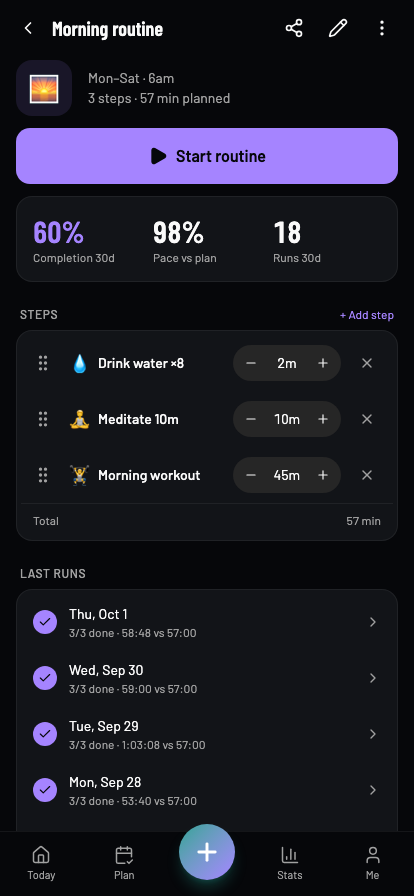
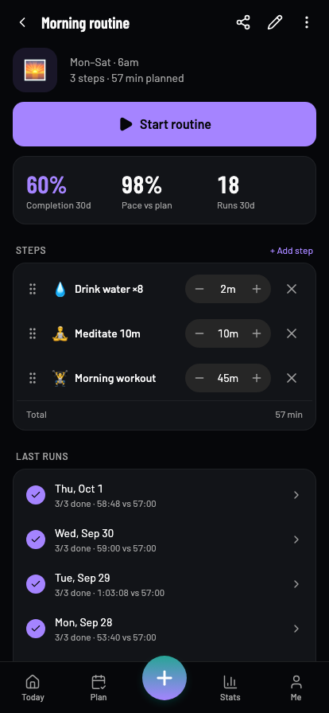

# Mobile visual migration evidence — 2026-10-02

The deployed web prototype is the visual reference. The Expo client uses native components and shared domain state/calculations.

- 95 route patterns captured in both clients at 414 × 896, dark mode, identical sample clock and fresh data. All ten contact sheets reviewed for composition.
- 190 additional route checks: 320px dark and 414px light. No runtime errors or document-level horizontal overflow. This check does not detect every clipped child; nutrition steppers received a separate narrow-screen correction.
- Targeted follow-ups covered capture, task capture, workout start, sharing, advisor and metric views in both themes, plus transaction/manual/photo/workout sheets.
- Browser flows exercised routine editing/player/completion; workouts and undo; journal/goal persistence; reviews; transactions; onboarding; import/undo; offline capture replay and interrupted processing recovery.

[Route results](route-audit.json) retain the full inventory and responsive results. Example comparison:

| Web reference | React Native web preview |
| --- | --- |
|  |  |

The screenshots are baseline evidence, not a claim of pixel-identical rendering. System pickers, permission prompts, safe areas and platform glyphs differ. Some complex share artwork and secondary dialog spacing remain approximate. Other themes, data states and device text sizes need continued review.

All visual and interaction evidence here ran in Chromium against Expo web. iOS/Android export validates compilation only. Physical-device gestures, keyboard, permissions, recording and native sharing still require device verification.

Final verification: mobile TypeScript passed; 50 tests across nine suites passed; Biome checked 290 files cleanly; Expo exported iOS, Android and web successfully. Expo Doctor passed 21/21 checks. Frontend TypeScript and Biome also passed. A final 320px check confirmed visible macro target values after the compact-control correction, with no runtime errors on nutrition targets, routine detail and dashboard sharing.
